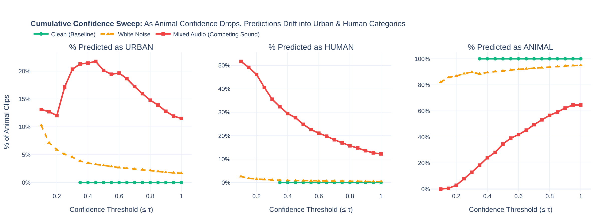
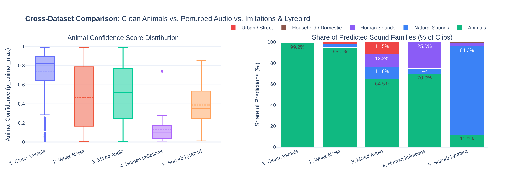
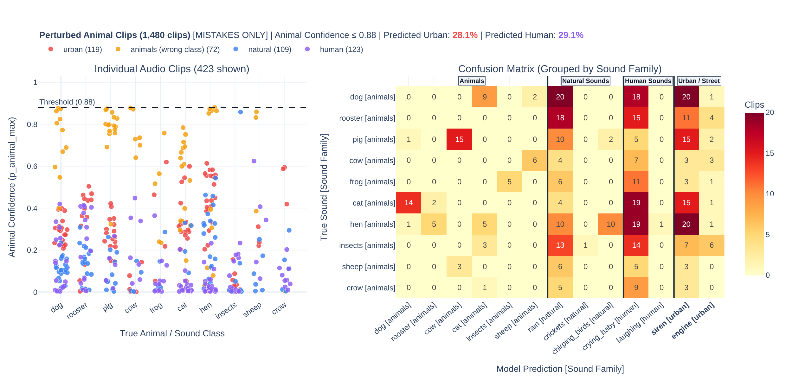

# AI Interaction Log (AI4VIS)

## Important Prompts Used
* Provided an overview of the Phase 1 goals and the available datasets (clean animals, noise, mixed audio, human imitations, lyrebird).
* Asked the AI to suggest specific visualizations to analyze confidence thresholds and model robustness.
* Prompted the AI to implement the suggested visualizations using Plotly.

## AI Suggestions & Decisions

* **Suggestion:** Create a Cumulative Confidence Sweep (line chart) showing prediction drift as confidence drops.
  * **Decision:** **Accepted.** This directly answered the assignment prompt regarding "errors/confidence change".

  

  **How to read the chart:**
  * **X-axis:** Represents the confidence threshold.
  * **Y-axis:** Shows the percentage of true animal clips predicted as a specific category.

  **We have three conditions:**
  * **Clean Baseline (in green):** Represents predictions on the original, unmodified animal recordings with no added sounds.
  * **White Noise (in yellow):** Just static background noise. It has no specific meaning (it doesn't sound like an animal, a person, or a vehicle).
  * **Mixed Audio (in red):** Where we take the animal sound and mix it with a distinct competing sound, like a siren or a crying baby.

  **Graph 1: % Predicted as URBAN**
  Starting with the leftmost graph, we look at how often the model wrongly guesses an Urban sound. The Clean Baseline in green is completely flat at 0%, meaning the model never confuses a pristine animal sound for a city sound. The White Noise in yellow starts around 10% on the left and drops below 5%. This tells us that while the generic static causes minor confusion in the hardest clips, the model mostly sees through it. However, the Mixed Audio in red spikes to over 22%. Because we mixed the animal sounds with urban distractors like sirens or engines, the model gets hijacked. Instead of hearing the animal, it confidently guesses the background noise.

  **Graph 2: % Predicted as HUMAN**
  Moving to the middle graph, we look at Human predictions. Again, the Clean Baseline in green is perfectly flat at 0%. The White Noise in yellow is also near 0%, which makes sense because generic static doesn't sound like a human voice. But looking at the Mixed Audio in red, at the lowest confidence threshold where the model is most confused, the percentage of animal clips misclassified as human starts at roughly 50%. This happens because we mixed the animal audio with human distractors, like a crying baby. The competing sound overwhelms the model, causing it to abandon the animal prediction entirely. The line only drops as we include higher-confidence clips where the animal sound was louder.

  **Graph 3: % Predicted as ANIMAL**
  Finally, the rightmost graph shows us the correct predictions. The Clean Baseline in green is a perfect, flat line at 100%. The White Noise in yellow starts around 82% and rises to 95%. Even when static makes the model unsure, it still knows the core signal is an animal. But the Mixed Audio in red is startling. On the far left, it starts at 0%. This means that for the most confusing mixed clips, the competing background sound entirely erases the animal's identity. The model only recovers to about 65% as we move to the right and include the clips where the animal sound was clear enough to overpower the distractor.

  These plots show that when we add generic static, the model gets a little unsure but stays mostly correct. But when we mix in a meaningful background sound, the model loses confidence as it is influenced by the distractor. It abandons the animal prediction and misclassifies the audio as a human or urban sound.

* **Suggestion:** Create a Cross-Dataset Comparison chart comparing animal confidence distributions and predicted sound families across clean animals, white noise, mixed audio, human imitations, and lyrebird mimicry.
  * **Decision:** **Accepted.** It provides a clear side-by-side overview of how confidence and predicted sound families shift across all five datasets.

  

* **Suggestion:** A confusion matrix grouped by sound family, filtered to show only mistakes.
  * **Decision:** **Accepted.** It hid the correct answers so we could easily see exactly when a background sound tricked the model (like guessing a siren instead of a dog).

  

* **Suggestion:** Build a 2D scatter plot (PCA) to map the model's outputs.
  * **Decision:** **Rejected (for Phase 1).** It involves looking at the model's internal workings rather than just its final outputs.

