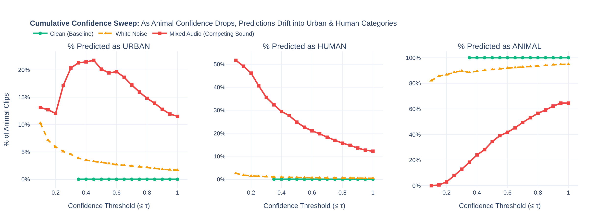
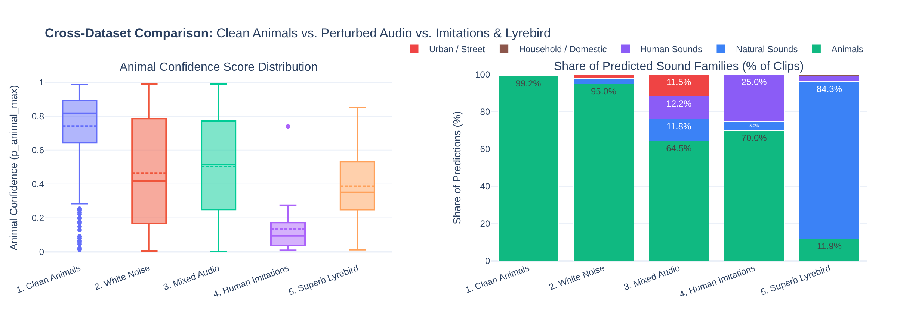
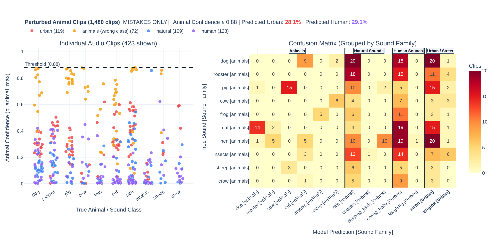

# AI Interaction Log (AI4VIS)

## Important Prompts Used
* Provided an overview of the Phase 1 goals and the available datasets (clean animals, noise, mixed audio, human imitations, lyrebird).
* Asked the AI to suggest specific visualizations to analyze confidence thresholds and model robustness.
* Prompted the AI to implement the suggested visualizations using Plotly.

## AI Suggestions & Decisions

* **Suggestion:** Create a Cumulative Confidence Sweep (line chart) showing prediction drift as confidence drops.
  * **Decision:** **Accepted.** This directly answered the assignment prompt regarding "errors/confidence change".

  

* **Suggestion:** Create a Cross-Dataset Comparison chart comparing animal confidence distributions and predicted sound families across clean animals, white noise, mixed audio, human imitations, and lyrebird mimicry.
  * **Decision:** **Accepted.** It provides a clear side-by-side overview of how confidence and predicted sound families shift across all five datasets.

  

* **Suggestion:** A confusion matrix grouped by sound family, filtered to show only mistakes.
  * **Decision:** **Accepted.** It hid the correct answers so we could easily see exactly when a background sound tricked the model (like guessing a siren instead of a dog).

  

* **Suggestion:** Build a 2D scatter plot (PCA) to map the model's outputs.
  * **Decision:** **Rejected (for Phase 1).** It involves looking at the model's internal workings rather than just its final outputs.

